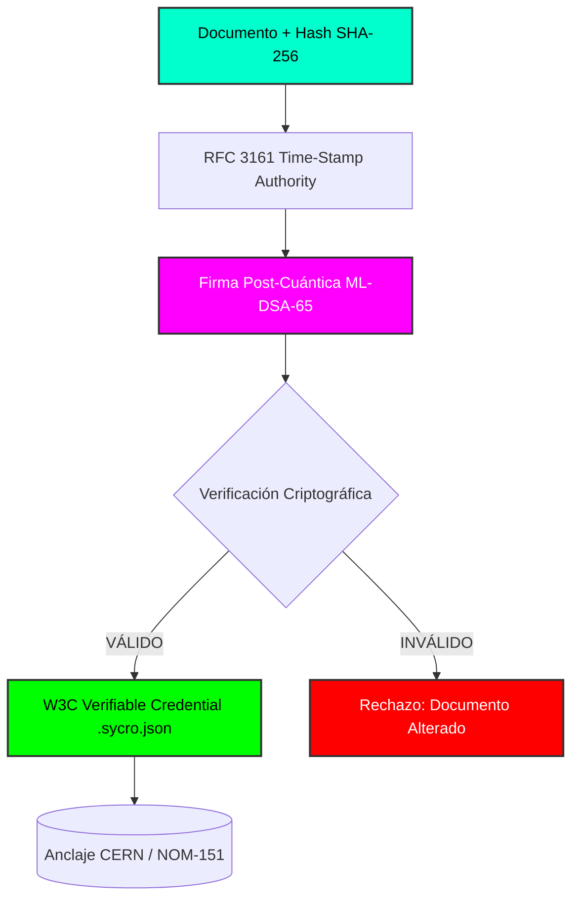

<div align="center">

[](https://git.io)

[](#)
[](#)
[](#)
[](#)
[](#)
[](https://doi.org)

<br />

> *"La criptografía post-cuántica no es el futuro. Es el presente, y acaba de aterrizar en el bolsillo de un humano en México."*

</div>

---

### 🧬 El Nacimiento de un Estándar

**SYCRO / KRONOS** es la intersección entre la soberanía de los datos, la criptografía resistente a computadoras cuánticas y los estándares legales de validez documental.

Este repositorio contiene el primer motor de validación offline capaz de leer metadatos **Dublin Core (XML)**, verificar firmas criptográficas generadas con **ML-DSA-65 (NIST FIPS 204)**, anclarlas al tiempo universal con **RFC 3161**, y emitir **Credenciales Verificables (W3C VC)**.

**Lo logramos en Termux.** Sin infraestructura millonaria. Sin excusas.

---

### 🚀 Instalación y Uso Rápido

Asegúrate de contar con **Node.js v18 o superior** antes de ejecutar el paquete:

```bash
# Instalación global desde NPM
npm install -g kronos-desk-val

# O ejecución directa sin instalar
npx kronos-desk-val <archivo>
```

---

### 🛠️ El Stack (Forjado en el Terminal)

<div align="center">
  
  
  
  
  
  
  
</div>

---

### ⚡ Arquitectura del Protocolo



<div align="center">

🔐 **"El código es ley. La criptografía es la verdad. La soberanía es tuya."**

Desarrollado con orgullo desde Toluca, México 🇲🇽 para el mundo.

</div>
